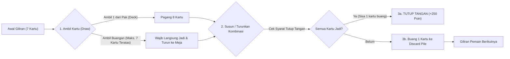
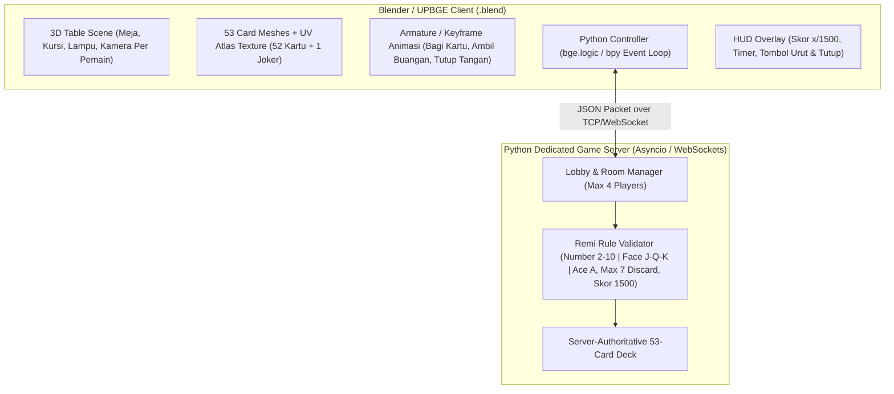

# Product Requirements Document (PRD): Remi Nusantara 3D Online (7 Kartu)

| Informasi Dokumen | Detail |
| :--- | :--- |
| **Nama Produk** | Remi Nusantara 3D Online (Versi 7 Kartu Indonesia) |
| **Genre** | 3D Multiplayer Online Turn-Based Card Game |
| **Jumlah Pemain** | 2 – 4 Pemain (Maksimal 4 Pemain) |
| **Jumlah Kartu Tangan** | 7 Kartu per Pemain (8 kartu saat giliran jalan sebelum buang) |
| **Komposisi Deck & Wild Card** | **53 Kartu** (52 Kartu Standar + **1 Joker**). Terdapat **4 Wild Card** setiap ronde: **1 Kartu Joker** + **3 Kartu yang se-angka dengan 1 kartu bukaan pertama** saat ronde dimulai. |
| **Syarat Wajib Seri (Kartu Urut)** | Pemain **WAJIB** memiliki minimal **1 kombinasi Kartu Urut (Seri minimal 3 kartu)** saat ronde berakhir. Jika tidak punya Seri min 3, pemain **tidak mendapat poin positif** dan **SEMUA kartunya (termasuk Tris di meja + tangan) menjadi TERBAKAR (minus semua)**. |
| **Target Skor Kemenangan** | **1.500 Poin** |
| **Engine & Tools Utama** | **Blender 2D Top-Down Orthographic (`RemiNusantara2D.blend`) + Web/TCP Multiplayer** |
| **Status Dokumen** | v3.0 – Wild Card Buangan Tidak Dapat Diambil (WILD MATI), Tutup dari Buangan Tutup Biasa (Bukan 250), Transisi Ronde Otomatis (Countdown 5s & Tanpa Tombol), Proteksi Wild Card, Pemain Skor Tertinggi Main Terus, Dashboard Interaktif, Drag & Drop, 4 Wild Cards, Seri Wajib Min 3 / Tris As, Penalti Umpan Tutup x10, & Tutup Tangan +250 |

---

## 1. Ringkasan Produk (Product Overview)

**Remi Nusantara 3D Online** adalah game kartu multiplayer 3D berbasis giliran (*turn-based*) yang mengadaptasi permainan **Kartu Remi Tradisional Indonesia (7 Kartu)** dan dikembangkan menggunakan **Blender (UPBGE / Blender Python)**. Permainan menggunakan **53 kartu** (52 kartu standar + **1 Joker**) dengan maksimal **4 pemain** dalam satu meja 3D interaktif. Setiap pemain memegang **7 kartu di tangan** dan berlomba mengumpulkan poin hingga mencapai target skor **1.500 Poin**.

---

## 2. Aturan Permainan (Core Game Rules)

### 2.1 Komponen Kartu (53 Kartu)
- **52 Kartu Standar** terdiri dari 4 Kembang (*Suit*):
  - ♠ **Waru / Sekop (Spades)**
  - ♥ **Hati / Love (Hearts)**
  - ♦ **Wajik / Berlian (Diamonds)**
  - ♣ **Keriting (Clubs)**
- **4 Wild Card Aktif (1 Kartu Joker + 3 Kartu Bukaan Pertama)**:
  - Dalam 1 pak terdapat **52 kartu standar + 1 Kartu Joker cetak** (Total deck = **53 kartu**).
  - Saat ronde dimulai (setelah masing-masing pemain dibagikan 7 kartu), **1 kartu dibuka dari Pak (`Kartu Bukaan Wildcard`)** dan diletakkan terbuka di samping Pak.
  - **3 kartu tersisa yang memiliki angka/nilai sama dengan kartu bukaan tersebut** + **1 Kartu Joker cetak** otomatis menjadi **4 Wild Card** pada ronde tersebut.
  - Ke-4 Wild Card berfungsi sebagai pengganti kartu apa saja dalam kombinasi **Seri** maupun **Tris** (mengikuti nilai poin kelompok yang digantikan saat jadi, atau penalti **-25 poin** jika mati/terbakar).

### 2.2 Persiapan & Pembagian Kartu (Dealing Phase)
1. **Penentuan Giliran Pertama (Starter & Aturan Pemain Skor Tertinggi Main Terus)**:
   - Pada ronde pertama, permainan dimulai oleh Pemain 1 (kursi 0 / acak) karena seluruh pemain masih memiliki 0 poin.
   - **Aturan Pemain Skor Tertinggi Main Terus (Reigning Leader Initiative)**: Pemain yang memiliki **akumulasi total skor tertinggi di klasemen** menjadi **pemegang giliran pertama (Starter)** dan akan **MAIN TERUS MENERUS** membuka ronde demi ronde selama ia masih memegang skor tertinggi!
   - Jika suatu ronde berakhir (baik karena Tutup Tangan, Tutup Biasa, atau Pak Habis), sistem menghitung skor dan menentukan pemimpin klasemen. Pemain dengan skor tertinggi akan tetap atau menjadi pembuka ronde berikutnya.
   - Status pemain yang berhak main terus ditandai dengan badge khusus **`[👑 SKOR TERTINGGI - MAIN TERUS]`** pada meja Blender 2D dan antarmuka Web LAN.
2. **Pembagian Kartu**:
   - Setiap pemain dibagikan **7 kartu tertutup**.
   - Sisa kartu (25 kartu jika 4 pemain) diletakkan tertutup di tengah meja sebagai **Pak / Stok (Draw Pile)**.
   - Giliran berputar **searah jarum jam (Clockwise)**.
3. **Transisi Ronde Baru Otomatis (Tanpa Tombol & Countdown 5 Detik)**:
   - Tombol manual "Ronde Baru" dihilangkan dari bar aksi agar tidak dapat terpencet secara tidak sengaja oleh pemain.
   - Begitu suatu ronde berakhir (`ROUND_OVER`), seluruh kartu tangan pemain terbuka (*face-up*) untuk verifikasi poin dan sistem langsung memulai **Countdown Otomatis 5 Detik** (`⏱ 5s... 4s... 3s... 2s... 1s`).
   - Setelah countdown 5 detik habis, ronde berikutnya langsung otomatis dibagikan dan dimulai secara mulus (*seamless auto-transition*).

### 2.3 Kombinasi Kartu Sah & Pemisahan 3 Kelompok Kartu (Number, Face Card, Ace)
Dalam aturan Remi Indonesia ini, kartu dibagi menjadi **3 kelompok terpisah yang TIDAK BISA digabung satu sama lain dalam urutan (Seri)**:

| Kelompok Kartu | Daftar Kartu | Kombinasi **Seri (Urut Sekembang)** yang Sah | Kombinasi **Tris / Kuartet (Sama Nilai)** yang Sah | Kombinasi **TIDAK SAH (Dilarang)** |
| :--- | :---: | :--- | :--- | :--- |
| **1. Kartu Angka (Number Cards)** | `2, 3, 4, 5, 6, 7, 8, 9, 10` | Urut sesama kartu angka satu kembang. Contoh: `2♥-3♥-4♥` atau `8♠-9♠-10♠` | 3 atau 4 kartu angka yang sama beda kembang. Contoh: `7♠-7♥-7♦` atau `10♠-10♥-10♦-10♣` | ❌ Tidak bisa digabung dengan `A` (`A-2-3`) ❌ Tidak bisa digabung dengan Face Card (`9-10-J` atau `10-J-Q`) |
| **2. Kartu Gambar (Face Cards)** | `J, Q, K` | Hanya urut sesama Face Card satu kembang: **`J - Q - K`** (Contoh: `J♦-Q♦-K♦`) | 3 atau 4 kartu gambar yang sama beda kembang. Contoh: `J♠-J♥-J♣` atau `K♠-K♥-K♦-K♣` | ❌ Tidak bisa digabung dengan angka `10` (`9-10-J` / `10-J-Q`) ❌ Tidak bisa digabung dengan `A` (`Q-K-A`) |
| **3. Kartu As (Ace)** | `A` | **Berdiri Sendiri** (Tidak memiliki kombinasi Seri/Urut) | 3 atau 4 kartu As beda kembang: **`A♠-A♥-A♦`** atau **`A♠-A♥-A♦-A♣`** | ❌ Tidak bisa digabung dengan `2` (`A-2-3`) ❌ Tidak bisa digabung dengan `K` (`Q-K-A`) |

> [!IMPORTANT]
> **Penggunaan 1 Kartu Joker**:
> Kartu Joker dapat menjadi pengganti (*Wildcard*) di dalam salah satu kelompok di atas (misal: `8♠ - 9♠ - Joker(10♠)`, atau `J♥ - Joker(Q♥) - K♥`, atau `A♠ - A♥ - Joker(A)`), tetapi **tetap tidak boleh menyambungkan lintas kelompok** (tidak boleh `10♠ - Joker - Q♠`).

### 2.4 Alur Giliran Pemain & Batas Ambil Buangan Maksimal 7 Kartu

#### Tahap 1: Mengambil Kartu (Draw Phase)
Pemain wajib memilih **salah satu**:
1. **Mengambil 1 Kartu dari Pak Tertutup (Draw Pile)**:
   - Kartu masuk ke tangan pemain (total di tangan menjadi 8 kartu).
2. **Mengambil Kartu dari Tumpukan Buangan Terbuka (Discard Pile) — Maksimal 7 Kartu**:
   - Tumpukan buangan ditampilkan berjejer di atas meja 3D.
   - **Batas Maksimal 7 Kartu**: Pemain hanya boleh mengambil kartu dari tumpukan buangan **maksimal hingga urutan ke-7 dari kartu buangan paling atas** (sehingga jumlah kartu yang terambil dari buangan paling banyak adalah **7 kartu**).
   - Kartu buangan yang berada di urutan ke-8 dan seterusnya ke bawah otomatis **Terkunci (Locked/Dead History)** dan tidak dapat diambil lagi.
   - **Syarat Wajib Jadi**: Kartu target paling bawah yang diambil dari buangan **WAJIB langsung menjadi kombinasi sah (Seri/Tris sesuai aturan 3 kelompok kartu)** bersama kartu di tangan pemain dan langsung diturunkan/dibuka di meja pada giliran itu juga. Semua kartu buangan di atas kartu target tersebut ikut masuk ke tangan pemain.
   - **Seri Dulu Sebelum Tris & Pengecualian Kartu As ('A')**: Selama pemain **belum memiliki Kartu Urut (Seri/Straight min 3 kartu) di meja**, kartu buangan **hanya boleh diambil jika langsung membentuk Seri/Straight (min 3 kartu)**. Mengambil buangan untuk **Tris/Kembar 3 kartu angka/gambar** baru diperbolehkan setelah memiliki minimal 1 Seri di meja. **Khusus kartu As ('A')**: pemain diperbolehkan mengambil kartu 'A' dari tumpukan buangan untuk langsung membentuk Tris/Kuartet As asalkan pemain **minimal sudah memiliki 2 kartu As di tangan** (sehingga tidak bisa ditarik hanya dengan 1 As + Joker).
   - **Proteksi Wild Card Saat Ambil Buangan (Anti-Eaten Wildcard)**: Sistem auto-meld saat mengambil kartu buangan secara ketat memprioritaskan kombinasi **natural (0 Wild Card dari tangan)**. Wild Card (Joker maupun Rank Wild) milik pemain **tidak akan pernah termakan secara otomatis**. Jika kartu buangan hanya dapat dibentuk dengan mengorbankan Wild Card dari tangan, pengambilan otomatis dicegah untuk melindungi kartu liar pemain; pemain dapat menggunakannya hanya jika secara sadar dan sengaja menandai/memilih kartu tangannya terlebih dahulu.
   - **Wild Card Buangan Tidak Dapat Diambil Pemain Lain (WILD MATI)**: Jika seorang pemain membuang kartu Wild Card (baik Joker cetak maupun salah satu dari 3 kartu liar yang se-angka dengan bukaan pertama), kartu Wild Card tersebut menjadi kartu mati di tumpukan buangan dan **TIDAK DAPAT DIAMBIL OLEH PEMAIN MANA PUN**. Semua kartu yang berada di bawah Wild Card tersebut pada tumpukan buangan juga otomatis **Terkunci (LOCKED)** agar pemain tidak bisa mengambil irisan yang mengikutsertakan Wild Card ke tangan. Pada UI Web dan Blender 2D, kartu ini ditandai dengan badge khusus **`WILD MATI`** serta dinonaktifkan dari klik dan drag.
   - **Pemilihan Kombinasi Holistik (Full Sequence / Anti-Stranded Card)**: Sistem mengevaluasi skor bersih seluruh tangan (*net score = total poin kombinasi - penalti kartu mati*) saat menentukan kombinasi buangan. Jika pemain memegang `7C, 9C, 10C` dan mengambil `8C`, sistem otomatis membentuk urutan utuh **`[7C-8C-9C-10C]`** (4 kartu) dan tidak memotongnya menjadi `7C-8C-9C` yang akan menelantarkan `10C` sebagai kartu mati di tangan. Apabila kartu ke-4 tersebut bisa membentuk kombinasi lain (misal Tris `10-10-10`), sistem memprioritaskan kombinasi dengan akumulasi skor tertinggi.

#### Tahap 2: Menyusun / Menurunkan Kartu (Meld Phase) & Fitur Nempel Meja (Layoff / Extend)
- Pemain menyusun kartu di tangan atau menurunkan kombinasi sah (Kelompok Angka `2-10`, Kelompok Gambar `J-Q-K`, atau Kelompok `A`) ke meja.
- **Menyambung / Nempel Kartu ke Meja (Layoff / Extend)**: Pemain dapat menyambungkan 1 atau lebih kartu dari tangan ke kombinasi kartu jadi yang sudah ada di meja miliknya (misal menyambung `10C` atau `6C` ke `[7C-8C-9C]` menjadi `[6C-7C-8C-9C-10C]`, atau menyambung kartu ke-4 ke Tris angka).
  - Dapat dilakukan dengan memilih kartu di tangan lalu menekan tombol **TURUNKAN PILIHAN (M)**.
  - Dapat dilakukan via **Drag and Drop** langsung dari tangan ke area Kartu Jadi (**Meld Zone**).
  - Tombol **AUTO TURUN (A)** secara otomatis menempelkan seluruh kartu sambungan yang cocok ke meja sambil tetap menjamin tersisa minimal 1 kartu untuk dibuang.

#### Tahap 3: Membuang 1 Kartu (Discard Phase) & Kendali Penuh Tangan
- Di akhir gilirannya, pemain **wajib membuang 1 kartu** ke *Discard Pile*.
- **Kendali Penuh Kartu di Tangan (Anti-Auto-Forced Meld)**: Saat membuang kartu biasa, kombinasi kartu di tangan pemain **TIDAK AKAN otomatis diturunkan ke meja**. Kartu tetap aman berada di tangan pemain sehingga pemain bebas menyimpan kartu untuk strategi Tutup Tangan (+250) atau menunggu momen terbaik. Kartu baru akan turun ke meja jika pemain secara sengaja menekan tombol **`AUTO TURUN (A)`** atau **`TURUNKAN PILIHAN (M)`** (kecuali saat membuang kartu penutup yang langsung menghabiskan sisa kartu untuk Tutup ronde).
- Jika pemain hanya mengambil 1 kartu teratas dari *Discard Pile*, pemain tidak boleh membuang kembali kartu yang sama pada giliran tersebut.

### 2.5 Fitur Jeda Permainan (Pause & Resume System)
- Permainan dapat dijeda kapan saja melalui tombol **`⏸️ PAUSE (ESC)`** di header atau action bar, maupun dengan menekan tombol **`ESC`** pada keyboard.
- Saat permainan dijeda (*Paused*):
  - Penghitung waktu giliran (*Turn Timer*) dihentikan total.
  - Giliran bot dan eksekusi AI dihentikan sepenuhnya.
  - Tampilan overlay khusus **PERMAINAN DIJEDA (PAUSED)** muncul di layar dengan tombol untuk melanjutkan permainan (**`▶️ RESUME`**) atau membuka dashboard pengaturan (**`⚙️ DASHBOARD`**).
- Menekan **`ESC`** kembali atau mengklik tombol Resume akan langsung melanjutkan pertandingan tanpa kehilangan progres atau waktu.

### 2.5 Kondisi Berakhirnya Ronde (End of Round Conditions)

1. **Tutup Tangan Murni (+250 Poin) vs Tutup Biasa**:
   - **Tutup Tangan Murni (+250 Poin)** diberikan **HANYA** jika pemain mengambil kartu dari **Pak Tertutup (Draw Pile)** dan menutup ronde langsung dari tangan **tanpa mengambil kartu dari tumpukan buangan** serta **tanpa pernah menurunkan Kartu Jadi terlebih dahulu pada giliran sebelumnya** (wajib memiliki minimal 1 kombinasi **Seri/Kartu Urut min 3 kartu** atau **Tris As min 3 kartu**). Skor ronde pemain tersebut **HANYA +250 Poin** (poin kartu-kartunya tidak ikut dihitung).
   - **Tutup Kartu Hasil Ambil Buangan (Bukan 250 Poin)**: Jika pemain menutup seluruh kartunya pada giliran di mana ia **mengambil kartu dari tumpukan buangan**, penutupan ini **BUKAN** Tutup Tangan Murni (+250), melainkan diperlakukan sebagai **Tutup Biasa**:
     $$\text{Skor Ronde} = \sum (\text{Nilai Kartu Jadi di Meja}) + (\text{Nilai Kartu Buangan Penutup} \times \text{Nilai Wild Card})$$
     Pemain pembuang kartu yang dimakan untuk menutup ronde tetap terkena **Penalti Umpan Tutup ×10**.
   - **Kombinasi Tris As dengan Wildcard**: 1 Kartu As asli + 2 Wildcard (atau 2 As + 1 Wildcard, atau 3 Wildcard) adalah kombinasi **Tris As** yang sah.
   - **Deteksi Otomatis & Tombol Tutup Tangan Murni**: Ketika kartu di tangan pemain telah lengkap membentuk kombinasi sah dan hanya menyisakan 1 kartu buang, sistem secara otomatis mendeteksi status **Siap Tutup Tangan**. Tombol **TUTUP TANGAN +250 (T)** akan menyala bersinar (*pulsating glow*) dan dapat langsung diklik oleh pemain untuk segera menutup ronde (sistem cerdas otomatis memilih kartu buangan sisa).
   - Jika pemain sudah memiliki Kartu Jadi di meja dari giliran sebelumnya lalu menghabiskan sisa kartunya, ronde berakhir sebagai **Tutup Biasa**. Pemain mendapat poin Kartu Jadi + **Bonus Tutup Biasa = Nilai Kartu Buangan Penutup × Nilai Wild Card** ronde itu (nilai: Angka = 5, Face = 10, As = 15, kartu Wild yang dibuang = 25). Contoh: menutup dengan membuang `K` (10) saat Wild Card adalah kartu angka (5) → **10 × 5 = +50 Poin**.
   - **Tidak ada Bonus Dragon**.
2. **Aturan Wajib Kartu Urut (Seri Min 3 Kartu) atau Tris As — Terbakar Semua**:
   - Saat permainan/ronde berakhir (baik karena ada pemain yang Tutup maupun karena Pak Habis), setiap pemain **WAJIB memiliki minimal 1 kombinasi Kartu Urut (`Seri` minimal 3 kartu berurutan sekembang) ATAU minimal 1 kombinasi Tris/Kuartet As (`A-A-A` / `A-A-A-A`)**.
   - Pemain yang **TIDAK memiliki Seri min 3 dan TIDAK memiliki Tris As** pada akhir ronde **tidak akan mendapatkan poin positif sama sekali (0 poin jadi)** dan **SEMUA kartunya (termasuk Tris/Kuartet angka/gambar di meja maupun sisa kartu di tangan) menjadi TERBAKAR (dihitung minus semuanya)**.
   - Pemain yang memiliki minimal 3 kartu As (`A-A-A`) dapat langsung menurunkannya ke meja tanpa harus memiliki kartu Seri terlebih dahulu.
3. **Penalti Umpan Tutup (Feeder Penalty x10)**:
   - Apabila seorang pemain mengambil kartu buangan dari pemain sebelumnya dan langsung menggunakan kartu tersebut untuk **TUTUP KARTU** (baik Tutup Tangan maupun Tutup Biasa), maka pemain yang membuang kartu tersebut terkena **Penalti Umpan Tutup** sebesar **Nilai Poin Kelompok Kartu × 10**.
   - Rincian penalti: Kartu Angka (`2-10` = 5 poin) → **-50 Poin**; Kartu Gambar (`J, Q, K` = 10 poin) → **-100 Poin**; Kartu As (`A` = 15 poin) → **-150 Poin**; Wildcard (`Joker` = 25 poin) → **-250 Poin**.
   - Penalti ini dipotong langsung dari total skor pemain pembuang.
4. **Pak Habis (Deck Exhausted)**:
   - Jika kartu terakhir di *Draw Pile* telah diambil dan setelah pemain tersebut membuang kartu belum ada yang berhasil Tutup, maka ronde berakhir tanpa bonus Tutup Tangan (+250). Setiap pemain yang memiliki minimal 1 Seri atau Tris As menghitung poin kartu jadi dikurangi kartu mati, sedangkan pemain tanpa Seri/Tris As otomatis **Terbakar Semua**.

### 2.6 Fitur Interaksi Drag & Drop (Blender 2D & Web LAN)
Mendukung interaksi intuitif mouse drag and drop penuh:
1. **Drag Kartu Tangan ke Area Buangan (`Discard Rail`)**:
   - Melepaskan kartu di area tumpukan buangan langsung membuang kartu tersebut sekaligus mengevaluasi kondisi Tutup Tangan (+250) atau Tutup Biasa secara otomatis.
2. **Drag Kartu Tangan ke Area Kartu Jadi (`Meld Zone`)**:
   - Menyeret kartu ke area kartu jadi otomatis menambahkan kartu ke pilihan kombinasi dan menurunkannya jika sah.
3. **Drag Antar-Kartu di Tangan (Reorder Hand)**:
   - Menyeret salah satu kartu tangan dan menjatuhkannya di atas kartu tangan lain langsung menata ulang posisi/urutan kartu di tangan tanpa batasan.
4. **Drag dari Pak / Buangan ke Tangan**:
   - Menyeret Pak ke area bawah langsung mengambil 1 kartu.
   - Menyeret kartu buangan yang tidak terkunci ke area bawah langsung mengambil tumpukan buangan dan otomatis menurunkan kombinasinya.
5. **Klik Singkat & Tombol Cepat Tetap Didukung**:
   - Klik singkat tanpa pergeseran kursor tetap berfungsi untuk memilih/batal pilih (*toggle*) kartu.
   - Shortcut keyboard (`SPACE`, `D`, `M`, `A`, `B`, `S`, `F`) serta tombol UI 2D tetap aktif 100%.

---

## 3. Sistem Skoring (Scoring System)

### 3.1 Nilai Poin per Kelompok Kartu

| Kelompok Kartu | Nilai jika **JADI** (`+`) | Nilai jika **MATI / Di Tangan** (`-`) | Aturan Kombinasi Sah |
| :--- | :---: | :---: | :--- |
| **Kartu Angka (`2` s/d `10`)** | **+5 Poin** | **-5 Poin** | Seri sesama angka (`2-10` sekembang) atau Tris angka sama |
| **Kartu Gambar / Face Card (`J, Q, K`)** | **+10 Poin** | **-10 Poin** | Seri `J-Q-K` sekembang atau Tris huruf sama (`J-J-J`, `Q-Q-Q`, `K-K-K`) |
| **Kartu As (`A`)** | **+15 Poin** | **-15 Poin** | **Berdiri Sendiri** (Tris/Kuartet sesama As: `A-A-A` / `A-A-A-A`) |
| **1 Kartu Joker** | **Mengikuti nilai kartu yang digantikan** | **-25 Poin** *(Penalti Joker Mati)* | Maksimal 1 di dalam deck (53 kartu) |

### 3.2 Bonus & Aturan Tutup

| Kondisi / Kejadian | Nilai Poin | Keterangan |
| :--- | :---: | :--- |
| **Tutup Tangan (Single Closing Bonus)** | **+250 Poin** | Satu-satunya bonus tutup ronde langsung dari tangan tanpa kartu jadi sebelumnya. |
| **Tutup Biasa (Closing with Discard x Wild)** | **Nilai Buangan × Nilai Wild** | Menutup setelah sebelumnya sudah memiliki kartu jadi di meja. |
| **Penalti Umpan Tutup (Feeder Penalty)** | **- (Nilai Kartu Buangan × 10)** | Dikenakan pada pemain yang membuang kartu jika kartu tersebut dimakan oleh pemain berikutnya untuk langsung menutup ronde. |
| **Bonus Dragon** | **TIDAK ADA (Dihapus)** | Tidak ada bonus dragon. |
| **Kebakaran (Tanpa Seri / Tris As)** | **Minus semua kartu (meja + tangan)** | Jika tidak memiliki minimal 1 Seri atau Tris As saat ronde selesai. |

### 3.3 Rumus Perhitungan Skor Ronde

$$\text{Skor Ronde} = \sum (\text{Nilai Kartu Jadi}) - \sum (\text{Nilai Kartu Mati}) + \text{Bonus Tutup Tangan (250 jika Tutup)}$$

#### Contoh Simulasi Skoring 1 Ronde:
- **Pemain 1 (Berhasil Tutup Tangan)**:
  - Kombinasi 1 (Kelompok As): `A♠ - A♥ - A♦` ($15 + 15 + 15 = +45$)
  - Kombinasi 2 (Kelompok Face Card): `J♣ - Q♣ - K♣` ($10 + 10 + 10 = +30$)
  - Kombinasi 3 (Kelompok Angka, jika pernah ambil buangan): `8♦ - 9♦ - 10♦` ($5 + 5 + 5 = +15$)
  - Kartu Mati: $0$
  - Bonus Tutup Tangan: **$+250$**
  - **Total Skor Ronde Pemain 1** = $45 + 30 + 15 + 250 = \mathbf{+340\text{ Poin}}$
- **Pemain 2**:
  - Kombinasi Jadi (Kelompok Angka): `7♠ - 8♠ - 9♠ - 10♠` ($5 + 5 + 5 + 5 = +20$)
  - Kartu Mati di Tangan: `A♣ (-15)`, `K♦ (-10)`, `5♥ (-5)` = $-30$
  - **Total Skor Ronde Pemain 2** = $20 - 30 = \mathbf{-10\text{ Poin}}$

### 3.4 Kondisi Kemenangan Match (Target Skor 1.500 Poin)
- Pertandingan berlangsung secara berkesinambungan dari ronde ke ronde hingga ada minimal satu pemain yang mencapai akumulasi skor **$\ge 1.500\text{ Poin}$**.
- Apabila pada akhir suatu ronde terdapat lebih dari 1 pemain yang melewati angka **1.500 Poin**, maka pemain dengan **total skor tertinggi** ditetapkan sebagai Pemenang Utama (Juara 1).

---

## 4. Sistem Dashboard, Pengaturan Meja & Matchmaking

### 4.1 Dashboard Sebelum Bermain (Pre-Game Settings Dashboard)
Sebelum memasuki ronde permainan, pemain disambut oleh **Dashboard Interaktif** (tersedia di Web LAN dan N-Panel Blender 2D) dengan opsi kustomisasi lengkap:
1. **Waktu Jalan per Giliran (Turn Timer)**:
   - **15 Detik**: Mode Blitz / Cepat (menantang ketepatan dan refleks cepat).
   - **25 Detik**: Mode Standar Turnamen Nusantara (waktu optimal untuk berpikir dan menyusun kartu).
   - **40 Detik**: Mode Santai (ideal untuk analisis taktis).
   - **60 Detik**: Mode Panjang.
   - **♾️ Tanpa Batas (Unlimited / Bebas)**: Waktu tanpa batas (bebas timeout/auto-discard, cocok untuk pemula atau mabar santai).
2. **Target Skor Kemenangan**:
   - **500 Poin**: Match Singkat (~2–3 Ronde).
   - **1.000 Poin**: Match Menengah (~3–5 Ronde).
   - **1.500 Poin**: Standar Resmi Nusantara (~4–8 Ronde).
3. **Jumlah Pemain**:
   - **2 Pemain**: Duel 1 vs 1 (Anda vs 1 Bot/Lawan).
   - **3 Pemain**: Formasi Segitiga (Anda vs 2 Bot/Lawan).
   - **4 Pemain**: Meja Penuh (Anda vs 3 Bot/Lawan).
4. **Nama Pemain & Kecepatan Bot AI**:
   - Kustomisasi nama pemain utama (kursi 0).
   - Kecepatan reaksi Bot AI: Cepat (0.4s), Normal (0.85s), Santai (1.5s).
5. **Akses Dashboard Kapan Saja**:
   - Tombol **`⚙ DASHBOARD / SETTING (P)`** di meja permainan dan shortcut tombol `P` memungkinkan membuka dashboard kapan saja saat permainan berjalan untuk menyesuaikan pengaturan atau me-restart match baru.

### 4.2 Alur Lobby & Matchmaking
1. **Quick Match (4 Pemain - Target 1.500 Poin)**:
   - Mencari hingga maksimal **4 pemain** secara otomatis.
   - Jika dalam 15 detik kursi belum penuh (minimal sudah ada 2-3 pemain), tersedia opsi mengisi slot kosong dengan **Bot AI** atau menunggu pemain asli.
2. **Custom Room (Mabar Kode Meja)**:
   - Host membuat meja dengan **6-Digit Room Code**.
   - Konfigurasi standar dikunci pada aturan utama: **Max 4 Pemain, 7 Kartu Tangan, 53 Kartu (1 Joker), Target Skor 1.500, Pemisahan Number/Face/Ace, Batas Ambil Buangan 7 Kartu, Bonus Tutup Tangan +250**.
   - Host dapat mengatur **Durasi Giliran** (15s / 25s / 40s).
3. **Ready Check & Sinkronisasi Scene Blender**:
   - Seluruh pemain di meja menekan tombol **SIAP (Ready)**.
   - Server mengirimkan *Seed/Initial Deal State* dan me-load scene meja 3D di Blender untuk ke-4 pemain secara serempak.

---

## 5. Aturan Pemain (Player Rules & Fair Play)

1. **Batas Waktu Giliran (Turn Timer: 25 Detik)**:
   - Jika waktu habis saat belum mengambil kartu: Sistem otomatis mengambil 1 kartu dari **Pak (Draw Pile)** dan membuang kartu tersebut.
   - Jika waktu habis saat sedang memilih tumpukan buangan namun belum menurunkan kombinasi sah: Aksi ambil buangan dibatalkan otomatis, diganti ambil 1 kartu dari Pak lalu dibuang.
2. **Validasi Batas 7 Kartu Buangan (UI & Server Guard)**:
   - Di atas meja 3D, hanya **7 kartu teratas** pada tumpukan buangan yang memiliki *Collider/Highlight* aktif dan bisa diklik oleh pemain.
   - Kartu ke-8 dst. diberi warna redup (*dimmed shader*) dengan ikon gembok kecil sebagai tanda tidak bisa diambil.
   - Server menolak request `TAKE_DISCARD` jika indeks kedalaman kartu $> 7$.
3. **Validasi Pemisahan Number (`2-10`), Face Card (`J-Q-K`), dan Ace (`A`)**:
   - Sistem validator kombinasi di client & server secara otomatis menolak percobaan penggabungan lintas kasta seperti `9-10-J`, `10-J-Q`, `Q-K-A`, atau `A-2-3`.
4. **Penanganan AFK & Reconnect**:
   - **2x Timeout Beruntun** mengaktifkan **Auto-Pilot Bot** sementara hingga pemain menekan tombol *"Kembali Bermain"*.
   - Jika koneksi terputus, pemain memiliki *Grace Period* untuk *Reconnect* kembali ke kursi yang sama tanpa kehilangan skor akumulasi menuju 1.500 poin.
5. **Server-Authoritative Anti-Cheat**:
   - Urutan 53 kartu di Pak dan kartu tangan lawan dihitung penuh di server Python. Klien Blender hanya menerima ID kartu milik sendiri dan kartu terbuka di meja.

---

## 6. Arsitektur Teknis Pembuatan Game di Blender

Karena game ini dibuat menggunakan **Blender**, berikut adalah rancangan arsitektur teknis untuk pengembangan 3D & Multiplayer-nya:

### 6.1 Komponen di dalam Blender (`RemiNusantara.blend`)
1. **Engine Runtime**:
   - Menggunakan **UPBGE (Uchronia Project Blender Game Engine)** berbasis Blender modern sehingga seluruh visual 3D (EEVEE Realtime Rendering), klik kursor pada kartu (*RayCast sensor*), animasi kartu melayang, dan skrip Python berjalan langsung di dalam Blender dan dapat di-export menjadi file **Standalone Executable (`.exe`)**.
2. **3D Assets & UV Mapping**:
   - **1 Base Card Mesh** tipis dengan *Bevel modifier* ringan dan **1 Texture Atlas** berisi 53 wajah kartu (52 kartu standar + 1 Joker) serta 1 desain punggung kartu khas Indonesia.
   - **Meja Remi 3D**: Memiliki 4 slot posisi kamera pemain (Selatan = Pemain Lokal, Barat = Pemain 2, Utara = Pemain 3, Timur = Pemain 4), 1 slot **Pak (Draw Pile)** di tengah, dan **Rel Tumpukan Buangan (Discard Rail)** yang menampilkan 7 kartu teratas secara berjejer jelas.
3. **Sistem Kamera & Interaksi Kartu**:
   - Kamera pemain menggunakan *Perspective View* menghadap ke tengah meja.
   - Saat kursor diarahkan ke kartu di tangan atau 7 kartu teratas di *Discard Pile*, kartu akan naik sedikit (*Hover Z-Offset +0.05m*) menggunakan Python controller.
4. **Jaringan (Python Socket / Asyncio)**:
   - Skrip `network_client.py` di dalam Blender menggunakan *non-blocking socket* yang dijalankan setiap *frame tick* di UPBGE untuk mengirim aksi (`DRAW_DECK`, `TAKE_DISCARD_INDEX`, `MELD_CARDS`, `DISCARD_CARD`, `DECLARE_TUTUP_TANGAN`) ke server Python.
