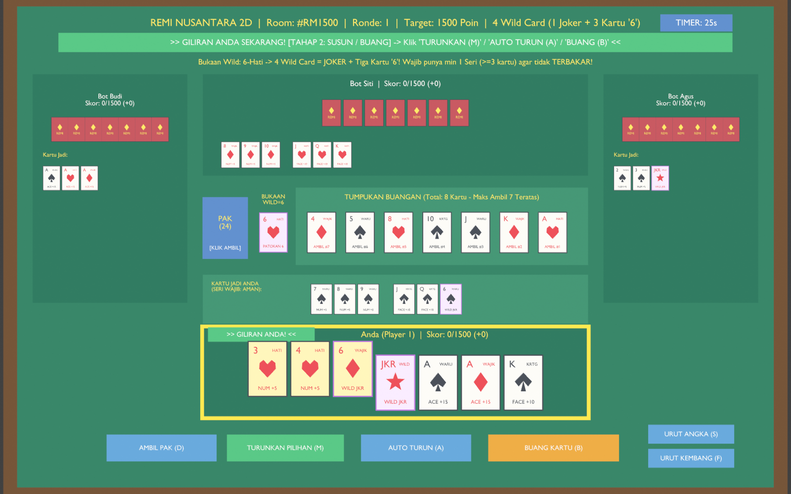

# 🃏 Remi Nusantara 2D (Remi Indonesia Online & Blender)

> Game kartu tradisional **Remi Indonesia (53 Kartu)** dengan implementasi aturan otentik nusantara, grafis Royale Edition, kecerdasan buatan (Bot AI), serta dukungan mode ganda: **Web Browser (PC/HP/LAN)** dan **Blender 3.6 2D Interactive Viewport**.



---

## 🌟 Fitur Utama

- **Aturan Otentik Remi Indonesia**:
  - **53 Kartu Standar**: 52 kartu remi + 1 Joker.
  - **4 Wild Card Dinamis**: 1 Joker + 3 kartu yang nilainya sama dengan kartu bukaan pertama di meja (misal bukaan pertama `8♥`, maka seluruh kartu `8` yang tersisa + `Joker` otomatis menjadi Wild Card).
  - **Sistem Nilai 3 Kelompok Kartu**:
    - Kartu Angka (2–10) = 5 poin.
    - Kartu Gambar / Face (J, Q, K) = 10 poin.
    - Kartu As (A) = 15 poin.
  - **Wajib Seri Min 3 (Urut)**: Pemain wajib memiliki minimal 1 kombinasi Seri Urut (3+ kartu kembang sama berurutan). Pemain tanpa Seri di akhir ronde terkena status **TERBAKAR (Hangus)** dan seluruh nilainya dihitung minus!
  - **Aturan Ambil Kartu Buangan**:
    - Wajib membentuk Seri Urut minimal 3 kartu (atau Tris As min 3).
    - Khusus kartu As (`A`), bisa diambil jika sudah memegang minimal 2 kartu As di tangan.
    - Pemain mengambil kartu buangan pilihan (hingga 7 kartu teratas) dan kartu yang dimakan otomatis turun jadi kombinasi valid di meja.
    - Wild Card buangan dilindungi dan tidak dapat diambil lawan.
  - **Tutup Tangan Murni (+250 Poin)**: Menutup ronde langsung dari tangan tanpa ada kartu jadi yang pernah diturunkan sebelumnya. Skor pemain lain dibekukan menjadi 0.
  - **Tutup Biasa**: Menurunkan kombinasi dan membuang 1 kartu penutup. Poin kartu buangan dikalikan dengan nilai kartu Wild.
  - **Pemain Skor Tertinggi Main Terus**: Pemain dengan skor akumulasi tertinggi selalu mendapat hak jalan pertama pada ronde berikutnya.

- **Tampilan Royale Edition (Web Browser)**:
  - Antarmuka elegan bernuansa meja beludru kasino Nusantara (*Felt Green & Gold Accents*).
  - **Zero-Overlap Architecture**: Kartu beresolusi tinggi dengan indikator sudut TL/BR, simbol kembang tengah, dan badge aksi BL yang tidak pernah bertumpuk.
  - **Responsive 100vh Viewport Budgeting**: Desain layout pas di layar laptop (768p) maupun desktop monitor (1080p), Action Dock selalu 100% terlihat.
  - **Drag and Drop & Keyboard Shortcut**:
    - `D`: Ambil Pak
    - `M`: Turunkan Pilihan
    - `A`: Auto Turun
    - `B`: Buang Kartu
    - `T`: Tutup Tangan
    - `S`: Urut Angka
    - `F`: Urut Kembang
    - `P`: Pengaturan Meja
    - `ESC`: Pause / Lanjutkan Permainan
  - **Multiplayer LAN / Hotspot**: Undang teman bermain di browser HP/Laptop lain di jaringan WiFi yang sama cukup dengan menyalin link kursi.

- **Mode Blender 3.6 2D Viewport**:
  - Model kartu dan meja 2D terintegrasi langsung dalam `RemiNusantara2D.blend` dengan procedural geometry dan shader material.

---

## 🚀 Cara Menjalankan

### 1. Mode Web Browser (Rekomendasi)
Cukup jalankan file batch:
```cmd
play_online_web.bat
```
Atau via terminal python:
```bash
python src/web_game_server.py
```
Lalu buka browser di: **`http://localhost:8080`**

### 2. Mode Blender 3.6 Interactive
Jalankan file batch:
```cmd
play_blender_2d.bat
```
Atau buka `RemiNusantara2D.blend` di Blender 3.6+, lalu jalankan skrip `src/blender_remi_2d.py` dari Text Editor Blender.

---

## 🧪 Pengujian Unit Test

Seluruh aturan Remi Indonesia telah diuji dan divalidasi dengan 21 skenario unit test menyeluruh:
```bash
python tests/test_remi_rules.py
```
Hasil:
```
[PASS] 4 Wild Card Aktif (1 JOKER + 3 Kartu '5' dari bukaan pertama '5C')
[PASS] Pemisahan 3 Kelompok Kartu (Number 2-10, Face J-Q-K, Ace A)
[PASS] Aturan Wajib Seri Min 3 (Kartu Urut) & Status Terbakar
[PASS] Tutup Tangan Murni (+250 Poin)
[PASS] Ambil buangan wajib straight min 3 & Khusus Kartu As
[PASS] Tutup Biasa (Nilai Kartu x Nilai Wild)
[PASS] Tris As min 3 aman tanpa seri
[PASS] Penalti umpan tutup x10
[PASS] Reorder hand & Drag-Drop
[PASS] Proteksi Wild Card di Buangan
[PASS] Aturan Pemain Skor Tertinggi Main Terus
[PASS] Jeda Permainan (Pause / Resume)
...
SEMUA UNIT TEST REMI INDONESIA v3.4 LULUS 100%!
```

---

## 📁 Struktur Direktori

```text
Playing Card/
├── src/
│   ├── remi_engine.py       # Engine aturan permainan Remi Indonesia lengkap
│   ├── web_game_server.py   # Web server lokal & antarmuka Royale Edition (HTML/CSS/JS)
│   ├── blender_remi_2d.py   # Controller interaktif viewport Blender 2D
│   ├── build_blend_2d.py    # Builder scene 2D procedural Blender
│   └── remi_network.py      # Modul networking LAN socket multiplayer
├── tests/
│   └── test_remi_rules.py   # 21 Test suite validasi aturan permainan
├── RemiNusantara2D.blend    # File master Blender 3.6
├── play_online_web.bat      # One-click launcher Web Browser
├── play_blender_2d.bat      # One-click launcher Blender 3.6
├── preview_remi_2d.png      # Gambar preview permainan
├── PRD.md                   # Dokumen Spesifikasi Aturan & Persyaratan
└── README.md                # Dokumentasi proyek
```

---

## 👨‍💻 Kontributor
- **Azki Fauzul Ramadhan** ([@azkifr](https://github.com/azkifr))

---
*Dibuat dengan bangga untuk melestarikan permainan kartu tradisional Remi Indonesia.*
